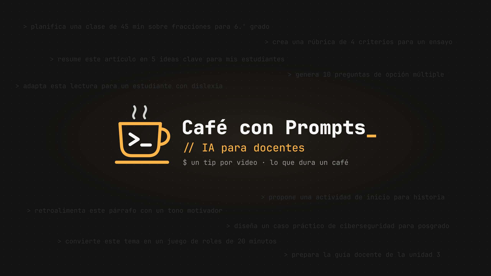

  

# ☕ Café con Prompts

Los prompts de los videos del canal de YouTube **[Café con Prompts](https://www.youtube.com/@cafeconprompts)**:
tips cortos para usar Claude y la inteligencia artificial en la práctica docente. Un tip por video,
lo que dura un café.

Están pensados para docentes de colegio y universidad. Puedes copiarlos, adaptarlos a tu materia y
compartirlos.

## Cómo usar un prompt

1. Abre el prompt que necesitas en la carpeta [`prompts/`](prompts/).
2. Copia el bloque **Prompt**.
3. Reemplaza los `[campos entre corchetes]` con los datos de tu clase.
4. Pégalo en [Claude](https://claude.ai) o en el asistente de IA que uses.
5. Revisa siempre el resultado con tu criterio docente antes de usarlo en el aula.

## Índice

| Categoría | Para qué | Prompts |
|---|---|---|
| [Planificación](prompts/planificacion/) | Clases, unidades didácticas, sílabos | Próximamente |
| [Evaluación](prompts/evaluacion/) | Rúbricas, exámenes, actividades | [Rúbrica analítica](prompts/evaluacion/rubrica-analitica.md) |
| [Retroalimentación](prompts/retroalimentacion/) | Comentarios a trabajos de estudiantes | Próximamente |
| [Adaptación](prompts/adaptacion/) | Materiales para distintos niveles y necesidades | Próximamente |
| [Fundamentos](prompts/fundamentos/) | Cómo escribir mejores prompts | Próximamente |

Cada prompt sigue el formato de [`PLANTILLA.md`](PLANTILLA.md) y enlaza al video donde se explica.

## Sugerencias

¿Usaste un prompt y lo mejoraste? ¿Te gustaría un video sobre algún tema? Abre un
[issue](../../issues) o déjalo en los comentarios del canal.

## Licencia

Contenido bajo [CC BY 4.0](LICENSE): puedes usarlo y adaptarlo, incluso con fines comerciales,
citando la fuente (*Café con Prompts*, con enlace a este repositorio).

---

Proyecto independiente, sin afiliación con Anthropic. Claude es una marca de Anthropic.
